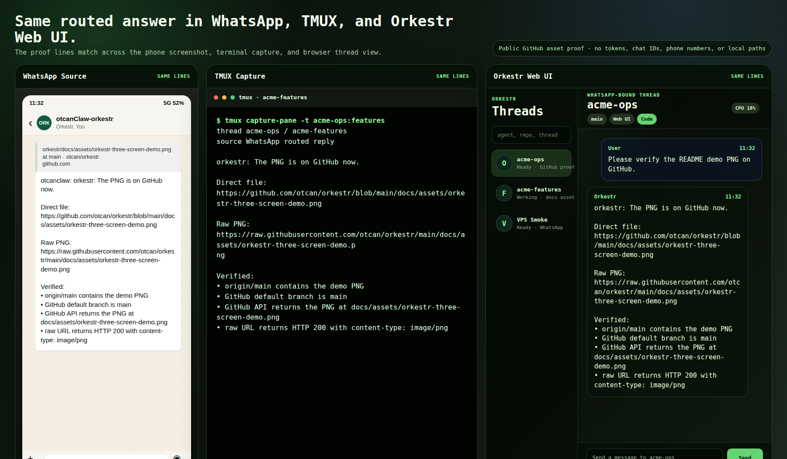
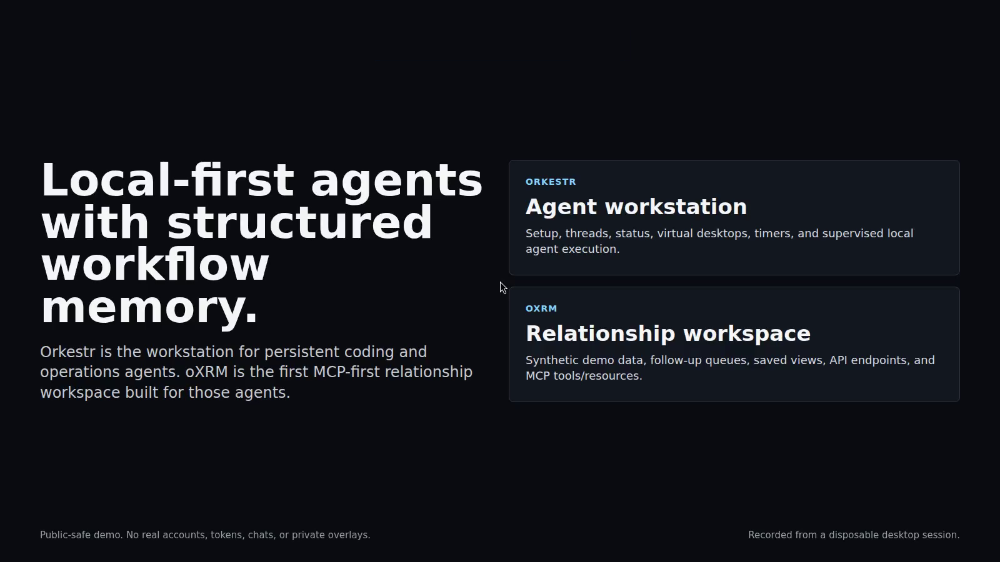
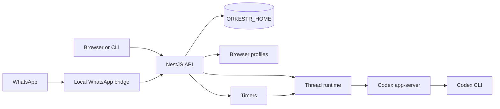

# Orkestr

**V2 Linux beta:** the current V2 pre-release is `v2.0.0-beta.5`. Follow the
[V2 Docker quickstart](v2/README.md) for the web UI, your own Codex CLI login
(Claude optional), Fast/Deep and timers. See the
[release notes](docs/releases/v2.0.0-beta.5.md) and
[release checklist](docs/v2/public-beta-checklist.md). It stays a pre-release
until the automated provider acceptance passes. The V1 setup below remains separate.

[](https://github.com/otcan/orkestr/actions/workflows/ci.yml)
[](LICENSE)
[](package.json)
[](docs/oss-managed-boundary.md)

**Run your coding agent, leave your desk, and stay in control.**

Orkestr is an open-source, self-hosted runtime for persistent agent jobs. A
job has a trigger (API, webhook, schedule or message), an agent, a task, tool
permissions and notifications. Its state is on disk, so it survives crashes
and restarts; recovery reconciles side effects instead of repeating them;
sensitive actions wait for your approval; and every run leaves an audit record.

- **Self-hosted.** Runs on your own machine or VPS. No account with us; the
  only credentials are the provider and connector logins you add.
- **No telemetry.** The runtime does not send usage data to us.
- **Provider-independent.** Providers sit behind one
  [adapter interface](docs/spec/adapter-interface.md). Today only Codex jobs are
  verified on a real provider (see the status below).

Positioning: [docs/product/positioning.md](docs/product/positioning.md).
Guarantees: [docs/spec/runtime-guarantees.md](docs/spec/runtime-guarantees.md).

### Start Orkestr

With Docker, nothing else to install:

```bash
docker run --name orkestr -p 127.0.0.1:3000:3000 -v orkestr-data:/data ghcr.io/otcan/orkestr:latest
```

Then open http://localhost:3000/. The first visit asks you to pick a username
and password; that is your login from then on.

From source (Node.js 22 or newer):

```bash
git clone https://github.com/otcan/orkestr.git
cd orkestr
npm ci
npm start
```

Then open http://127.0.0.1:19812/. The first `npm start` builds the server
once (about 15 seconds); after that Orkestr starts in about a second. `npm ci`
does not download a separate Chrome (about 650 MB): linking WhatsApp uses the
Google Chrome or Chromium installed on your computer (or `WA_CHROME_PATH`).

Orkestr needs a coding agent: the app opens only after Codex (your ChatGPT
subscription) or Claude Code is connected. The first-run wizard walks you
through it.

### Your first real job

After `codex login` on the same host, from the clone (`npx orkestr` runs this
checkout's CLI, also when an older `orkestr` is installed globally):

```bash
npx orkestr init my-jobs
npx orkestr run my-jobs
```

Details: [docs/quickstart.md](docs/quickstart.md) and
[docs/spec/agent-job-runner.md](docs/spec/agent-job-runner.md).

### What works today (2026-10-11)

Evidence levels: **simulation** (simulated provider or fake external systems
only), **offline-tested** (automated tests, no live service), **live-verified**
(observed on a real provider or released build in a controlled test).

<!-- status:start (keep in sync with the status table on the public /open-source page) -->
| Capability | Status | Evidence |
| --- | --- | --- |
| Codex jobs | live-verified once on production build (approval pause -> approve -> single-use approval consumed, effect ledgered) | live-verified |
| Claude Code jobs | NOT supported yet (permission hook not enforced in live test; refused unless configured) | offline-tested |
| YAML/JSON job specs | verified | live-verified |
| WhatsApp/email notifications | built, not live-verified | offline-tested |
| Webhooks (HMAC) | built and tested offline | offline-tested |
| Guarantees G1-G11 | tested with simulated/fake providers | simulation |
<!-- status:end -->

Codex jobs, tested configuration: Codex CLI 0.157.1 job, approval-gated file
change, live-verified once on release main-a343edf1ac91. One run is not a
reliability measurement; other Codex versions and tool mixes are untested.

Claude Code jobs are not working: in the one live test the per-call permission
hook did not run, so tool approvals were not enforced. Production refuses
Claude Code jobs unless a job login is configured. A host whose own Claude login is active
can still start Claude Code jobs today; set
`ORKESTR_AGENT_JOB_CLAUDE_CODE_EXECUTOR=0` to turn them off. Anything not in
this table should be treated as unverified. There is no public or hosted job
runner.

### Beyond jobs

Orkestr is also a local-first workstation for running persistent coding and
operations agents interactively. It gives Codex a durable home with
persistent threads, browser control, status, interruptions, WhatsApp routing,
timers, and local ops from a web UI or CLI. oXRM is the first workflow app built on the
same model: an MCP-first relationship workspace with structured relationship
memory, follow-up queues, and human-approved actions. For job applications and
LinkedIn outreach, see [Job Application And Outreach
Workflow](docs/job-application-workflow.md).

> Public alpha. The Docker/Helm path is the primary OSS demo path. Browser
> pairing gates remote access; do not expose raw Orkestr API, thread, desktop,
> or terminal routes directly to the public internet.



The generated README asset combines a generated WhatsApp source panel, a fresh
TMUX capture, and an Orkestr Web UI rendering. It must not contain real tokens,
phone numbers, chat IDs, local paths, or private hosts.

## Live Demo Recording

[](docs/assets/orkestr-oxrm-live-demo.mp4)

The live desktop recording shows Orkestr setup, a queued demo coding-agent
thread, the oXRM Docker dashboard, and MCP/CLI proof using disposable state and
synthetic demo data only. Reproduce it with:

```bash
npm run demo:record:live
```

## Why This Exists

Use Orkestr when one terminal Codex session stops being enough:

- you want named Codex threads that survive disconnects
- you want to control Codex from a browser or phone
- you want queue, status, approvals, interruptions, and history
- you want optional WhatsApp routing into a thread
- you want a private workstation or VPS instead of a hosted control plane

If you only need one interactive Codex terminal, use Codex directly.

## Why Not Just tmux?

tmux is a great primitive for keeping a terminal alive. Orkestr keeps that
operator ergonomics but adds the parts people otherwise rebuild around tmux:
setup, browser and phone control, thread status, interrupt and recovery paths,
timers, connector routing, persistent history, and a safer localhost-first
remote-access model.

## How Orkestr And oXRM Fit Together

Orkestr is the local-first workstation for persistent coding and operations
agents.

oXRM is the first workflow app built for that model: an MCP-first relationship
workspace that gives agents structured relationship memory, follow-up queues,
and safe human-approved actions.

Use Orkestr when you need to run and supervise agents. Use oXRM when those
agents need relationship state.

## What Orkestr Is Not

Orkestr is not a hosted SaaS, a team RBAC platform, a generic chatbot UI, or a
replacement for Codex. It is also not safe to expose directly to the public
internet without browser pairing plus a protected remote-access layer such as
Tailscale, Caddy/TLS, or a VPN.

## Known Limitations

- Public alpha: the first-run loop is still optimized for technical operators.
- The Docker/Helm OSS demo path is stronger than every host-native edge case.
- Connector setup depends on user-owned credentials and local browser state.
- WhatsApp, Gmail, LinkedIn desktop, and timer features should be treated as
  optional capabilities, not mandatory cloud services.
- Team RBAC, hosted multi-user SaaS, and plugin marketplace abstractions are
  intentionally outside V1.

## Quickstart

See [Start Orkestr](#start-orkestr) and [docs/quickstart.md](docs/quickstart.md).

### Docker

```bash
docker run --name orkestr -p 127.0.0.1:3000:3000 -v orkestr-data:/data ghcr.io/otcan/orkestr:latest
```

Then open:

```text
http://localhost:3000/
```

The first visit asks you to create your login (username and password); after
that you sign in with it. Use `localhost`, not `0.0.0.0` (Orkestr redirects
`0.0.0.0` there): browsers treat `localhost` as secure, so copying and
encrypted attachments work. `-p 127.0.0.1:3000:3000` keeps Orkestr reachable
only from your computer; the first person to open a fresh install picks the
login, so do not publish the port to a network before you have created it.
Approving a browser with a command still works:
`docker exec orkestr orkestr connect approve <code shown on the page>`.

Images are published for amd64 and arm64 (Apple Silicon).

Images are published to `ghcr.io/otcan/orkestr`: `latest` and `vX.Y.Z` for
releases, `main` and `sha-<commit>` for the current `main` branch.

The container stores Orkestr state in `/data`, including workspaces, browser
profiles, secrets, and `CODEX_HOME=/data/codex`.

First run is a three-step wizard (it opens by itself at `/` and at a bare
`/setup`):

1. **Link WhatsApp** (can be skipped). Without a configured broker the default is
   **Use my own WhatsApp**: the wizard shows a QR code, you link WhatsApp on
   your phone (Settings → Linked devices), and the session is stored only in
   the `/data` volume. After a container restart the linked account
   reconnects without a new QR (set `ORKESTR_WHATSAPP_AUTOSTART=0` to turn
   that off). The Orkestr relay is invitation-only and needs a broker.
2. **Connect the AI**: sign Codex in right in the wizard with a one-time
   ChatGPT device code (allow device-code sign-in in ChatGPT → Settings →
   Security first), or pick a Claude Code account if enabled.
3. As soon as the AI is signed in, Orkestr starts the default `orkestr` thread. With WhatsApp linked, the wizard binds
   the thread to your own WhatsApp chat ("Message yourself") on exactly the
   account you just linked. Nobody else is added, even if default
   participants are configured, and the step is refused if that account is
   no longer linked. It then waits for you to send a message there and for
   the thread's reply.
4. Orkestr starts Virtual Desk for that thread.

Everything optional (Gmail, browsers, security, secrets, backups, your
timezone) lives in Setup at `/setup/<section>`. Leaving Setup from the wizard
("More … options", then "Back to Orkestr") returns to the same wizard step.

The built-in bridge uses WhatsApp Web through the bundled Chromium. WhatsApp
does not officially support automating WhatsApp Web, so use an account you
are comfortable linking. Design notes and the remaining plan for the managed
gateway are in [docs/whatsapp-docker-onboarding-plan.md](docs/whatsapp-docker-onboarding-plan.md).

For WhatsApp deployments with more than one phone/account, keep the stable
routing account separate from explicit skill-only accounts. See
[WhatsApp Account Operations](docs/whatsapp-account-operations.md).

### Private VM Demo

The demo does not need a permanent public app URL. Run Orkestr on a VM and
provide the target WhatsApp number:

```bash
ORKESTR_DEMO_WHATSAPP_NUMBER="+4917600000000"
```

When the VM is up, Orkestr sends that number one WhatsApp readiness message
through the broker's WhatsApp router. Before creating the setup link, the VM
registers with the Orkestr broker through `POST /api/broker/instances/register`,
declares only a hash of the target WhatsApp chat, and receives a broker-generated
UUID plus encrypted channel bootstrap material. The OSS VM does not need
WhatsApp accounts, bridge URLs, bridge tokens, or router account ids.

Configure a stable public base URL such as `https://connect.orkestr.de`; Orkestr
sends a challenge-gated `/i/<broker-uuid>/setup` link on that host. That path is
the instance identity boundary: it redirects into browser pairing with the
broker UUID attached before setup opens. The setup flow then lets you connect
Codex, use the broker-provided WhatsApp relay or connect your own WhatsApp later,
and start the default `orkestr` thread.

Operators can pre-provision these broker values in the VM image, Helm release,
or secret manager so evaluators only edit the WhatsApp number:

```bash
ORKESTR_BROKER_REGISTRATION_TOKEN="..."
```

Optional URL overrides:

```bash
# Use a known public base URL and still route through browser pairing.
ORKESTR_CONNECT_PUBLIC_BASE_URL="https://connect.orkestr.de"

# Or provide an exact public setup/pairing URL without an instanceId.
# Exact overrides remain supported; the notifier adds instanceId=<broker-uuid>.
ORKESTR_CONNECT_PUBLIC_SETUP_URL="https://connect.orkestr.de/setup/pairing?return=%2Fsetup"
```

Cloudflare quick tunnel fallback is for local ad hoc testing only. It is off by
default; enable it explicitly with `ORKESTR_DEMO_CLOUDFLARE_FALLBACK=1` or Helm
`demo.cloudflareFallback: true`. For demo-review runs, set
`demo.publicBaseUrl` or `demo.setupUrl` instead.

Localhost setup links are blocked by default for WhatsApp onboarding. Use
`ORKESTR_DEMO_ALLOW_LOCAL_SETUP_URL=1` only for local tests.

For the full VM isolation checklist, including broker UUID routing, per-VM
runtime homes, desktop containment, update timer checks, and the audit command,
see [Isolated OSS Demo Runbook](docs/isolated-oss-demo.md). On a demo VM, run:

```bash
npm run audit:isolation
```

### Helm

```bash
helm install orkestr ./charts/orkestr
```

### Source/Host-Native

```bash
git clone https://github.com/otcan/orkestr.git
cd orkestr
npm ci
npm run build
ORKESTR_HOME="$PWD/.orkestr-data" CODEX_HOME="$PWD/.orkestr-data/codex" ORKESTR_PORT=3000 ORKESTR_HOST=127.0.0.1 npm start
```

The host-native installer still exists for private workstations and VPS installs:

```bash
curl -fsSL https://raw.githubusercontent.com/otcan/orkestr/main/scripts/install.sh | bash
```

Useful server commands:

```bash
orkestr status
orkestr logs
orkestr doctor
orkestr security approve <challenge-id>
orkestr security sessions
```

## Demo

Run the OSS demo contract smoke:

```bash
npm run smoke:k3s:oss-demo
```

It checks the Docker contract, Helm chart, first-run `orkestr` path, WhatsApp
trust choice, Virtual Desk startup wiring, and verifies the demo path is not
using the noop executor.

For a live k3s smoke on a host with Docker, Helm, and kubectl:

```bash
ORKESTR_K3S_OSS_DEMO_EXECUTE=1 npm run smoke:k3s:oss-demo
```

### Tenant VM Slice Provisioning

Operators can create and provision an isolated tenant VM slice from the CLI. The
command is idempotent for an existing slice id or existing owner slice, and it
returns a dry-run KubeVirt plan by default:

```bash
orkestr vm-slice create alice \
  --id alice-slice \
  --namespace tenant-alice \
  --vm-name alice-vm \
  --wa-participant owner-contact@c.us \
  --repo-url https://github.com/otcan/orkestr.git
```

WhatsApp participants supplied during slice creation are also stored as admin
participants by default. Use `--no-wa-admin` only when the contact should be a
regular participant.

Apply the generated KubeVirt manifest only when ready:

```bash
orkestr vm-slice create alice \
  --id alice-slice \
  --namespace tenant-alice \
  --vm-name alice-vm \
  --repo-url https://github.com/otcan/orkestr.git \
  --execute
```

Useful follow-ups:

```bash
orkestr vm-slice list
orkestr vm-slice status alice-slice
orkestr vm-slice provision alice-slice --execute
```

The deterministic coding-agent demo is still available for local development
and CI. It uses a temporary `ORKESTR_HOME`, a fake Codex app-server, and does
not require Codex sign-in or connector credentials:

```bash
npm run demo:coding-agent
```

Expected result: the command prints `Coding-agent demo passed`, creates a
temporary `demo-coding-agent` thread, prepares the virtual desktop profile, and
queues one safe read-only task before cleaning up.

For a real Codex walkthrough that does require Codex sign-in, use
`examples/coding-agent-demo/README.md`.

## What Is Included

- setup UI at `/setup`
- named Codex threads with status, queue, stop, attach, and history
- built-in specialist task agents that return scoped results to a parent Codex thread
- Codex app-server based thread runtime for new coding threads
- web UI and CLI control
- optional built-in local WhatsApp bridge
- optional timers
- Virtual Desk browser profiles
- secure-input secret manager
- local health checks, logs, smoke tests, and release checks

## Architecture



More detail: [docs/architecture.md](docs/architecture.md).
One-glance diagram: [docs/architecture-diagram.md](docs/architecture-diagram.md).

## Security Model

Orkestr can wake agents, pass text into runtimes, open browser profiles, and
store connector state under `ORKESTR_HOME`.

Default remote rules:

- keep Orkestr bound to `127.0.0.1`
- use Tailscale or Caddy/TLS for remote access
- keep browser pairing enabled
- keep real credentials, browser profiles, WhatsApp sessions, private prompts,
  and hostnames out of this repo
- keep skill-only WhatsApp accounts out of Orkestr router account env and
  bindings
- use secure-input or host secret storage for secret values

See [SECURITY.md](SECURITY.md).

Generated attachments and exports can be configured for mandatory publication
as recipient-encrypted age files. Enrollment includes a private-key possession
challenge, and the private identity stays in the browser. See
[docs/attachment-encryption.md](docs/attachment-encryption.md).

## Updates And Releases

### On-Box Update Watcher

For a personal VPS that tracks `main`:

```bash
curl -fsSL https://raw.githubusercontent.com/otcan/orkestr/main/scripts/install.sh | sudo bash -s -- --systemd --track-main
```

This installs `orkestr-update.timer`. New commits become versioned releases such
as `main-<short-commit>`.

Useful commands:

```bash
orkestr update status
sudo orkestr update
sudo orkestr rollback
```

### Versioned Git Releases

For stricter installs, deploy an exact tag:

```bash
sudo orkestr update --release --ref v0.1.0-alpha.26 --channel production
orkestr-deploy status
orkestr-deploy rollback
```

The running app reports release metadata at `/api/version`.

More detail: [docs/framework-deployment.md](docs/framework-deployment.md).

## OSS vs Managed

This public repo is the OSS distribution: the self-hosted Codex control center.
It should install and run without private operator state.

Managed/private deployment code belongs outside this repo and may add private
overlays, production routing, managed broker inventory, and real account
bindings.

See [docs/oss-managed-boundary.md](docs/oss-managed-boundary.md).

## Documentation Map

- [User guide](docs/user-guide.md)
- [Task agents](docs/task-agents.md)
- [Framework and deployment](docs/framework-deployment.md)
- [LLM-assisted release procedures](docs/llm-assisted-release-procedures.md)
- [Test storage isolation](docs/test-storage-isolation.md)
- [OSS vs managed boundary](docs/oss-managed-boundary.md)
- [Architecture diagram](docs/architecture-diagram.md)
- [Demo script](docs/demo-script.md)
- [Minimal landing page](docs/landing-page.md)
- [Secret manager](docs/secret-manager.md)
- [Hush mobile Realtime gateway](docs/mobile-realtime.md)
- [Security](SECURITY.md)
- [Contributing](CONTRIBUTING.md)
- [Roadmap](ROADMAP.md)

## Development

```bash
npm ci
npm run build
npm test
```

Use the npm test commands so the temporary-home bootstrap loads before the
application. See [test storage isolation](docs/test-storage-isolation.md).

Release and live E2E work uses the
[LLM-assisted release procedures](docs/llm-assisted-release-procedures.md).
Those procedures inspect the current change surface, choose the required checks,
classify failures, and produce an evidence packet. Npm scripts remain available
as command primitives, including `npm run pipeline:full`, but the procedure is
the source of truth for deciding which gates are required.

When changing the UI, run `npm run web:build` and commit the updated `dist/web`
bundle.

The web build is deterministic for a given source tree and `package-lock.json`.
`web:build` warns when `node_modules` drifts from the lockfile; run `npm ci`
before building, otherwise a different minifier version rewrites
`dist/web/browser/main.js` even without UI changes. If `dist/web` shows a diff
you did not cause, revert it with `git checkout -- dist/web`.

### Connector Outbox Storage

The connector outbox uses SQLite by default when `node:sqlite` is available.
Existing `connector-outbox.json` state is migrated into
`connector-outbox.sqlite` on first use, then hot outbox actions use indexed
SQLite updates instead of rewriting the JSON file. Set
`ORKESTR_CONNECTOR_OUTBOX_STORE=json` only as an emergency legacy fallback.

For managed-scale deployments, set `ORKESTR_CONNECTOR_OUTBOX_STORE=postgres`
and provide either `ORKESTR_CONNECTOR_OUTBOX_POSTGRES_URL` or the
`ORKESTR_CONNECTOR_OUTBOX_PGHOST` / `PGPORT` / `PGDATABASE` / `PGUSER` /
`PGPASSWORD` connection variables. Existing `connector-outbox.json` state is
migrated into the Postgres table on first use when the table is empty.

## License

MIT. See [LICENSE](LICENSE).
